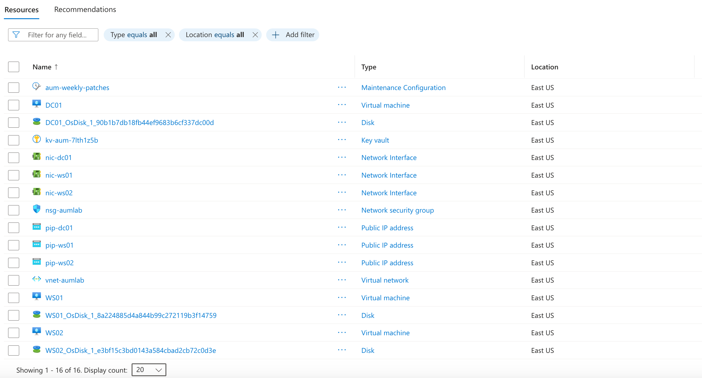
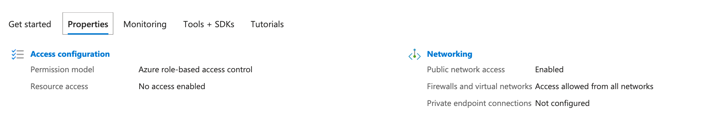
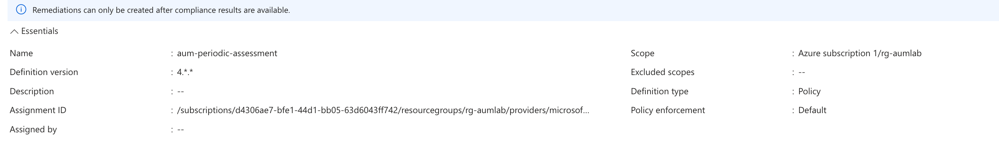

# Azure Update Manager Lab — Modular Terraform Patch Management Pipeline

A complete patch-compliance pipeline built with modular Terraform: policy-based auto-enrollment, a scheduled maintenance window, and live compliance validation across a 3-VM Active Directory domain.

## Repository Structure

```
azure-update-manager-lab/
├── backend.tf
├── versions.tf
├── variables.tf
├── main.tf
├── outputs.tf
├── terraform.tfvars.example
├── modules/
│   ├── networking/main.tf
│   ├── keyvault/main.tf
│   ├── compute/main.tf
│   └── update-manager/main.tf
└── scripts/
    └── validate-lab.ps1
```

This is the third and most complex of three connected Azure infrastructure projects — [NTFS File Server](https://github.com/LangstonCodes/azure-ntfs-file-server-lab) (file-level access control), [RBAC](https://github.com/LangstonCodes/azure-rbac-lab) (infrastructure-level access control), and this one (patch compliance). Fully standalone — no dependency on the other two.





## The Problem This Solves

Knowing one server is missing a patch is easy. Knowing which of hundreds of servers are missing which patches, on a consistent schedule, with a report you can hand to an auditor, is the actual operational problem. Azure Update Manager is the cloud-native answer to it — agentless, policy-driven, with both automatic and manual patch workflows.

## Architecture

- **DC01** — domain controller, promoted via CustomScriptExtension, static private IP
- **WS01 / WS02** — member servers, domain-joined, standing in for production workloads
- **Modular Terraform** — four independent modules (`networking`, `keyvault`, `compute`, `update-manager`), each owning one concern, wired together from a single root `main.tf`
- **Azure Policy** — auto-enrolls every VM in the resource group into periodic patch assessment
- **Maintenance Configuration** — defines the weekly patch window, target classifications (Critical, Security, UpdateRollup), and reboot behavior
- **Maintenance Assignments** — link that schedule to each individual VM (assessment and patching are separate operations — a VM can be assessed without ever being patched)

## Stack

- **Terraform** (HCL, modular) — networking, secrets, compute, and patch policy as independently owned modules
- **Azure CLI** — provider registration, on-demand assessment triggers
- **PowerShell + Az module** — live compliance validation, JSON report export

## What I Learned

This lab had the most real bugs of the three projects I've built — and every one of them traced back to the platform having moved since the reference material was written, not to anything I typed wrong.

**A "Modify" Azure Policy requires an explicit managed identity now.** The built-in periodic-assessment policy failed with `ResourceIdentityRequired` until I added an `identity { type = "SystemAssigned" }` block to the policy assignment — a requirement that didn't exist when older guides for this pattern were written.

**VMs need patch orchestration mode configured *before* a Maintenance Assignment will attach.** `azurerm_maintenance_assignment_virtual_machine` failed with `UnsupportedResourceOperation` until each VM explicitly set `patch_mode = "AutomaticByPlatform"` and `bypass_platform_safety_checks_on_user_schedule_enabled = true` on its OS profile.

**An Azure PowerShell cmdlet was renamed.** `Get-AzVMPatchAssessmentResult` no longer exists in the current `Az.Compute` module — it's `Invoke-AzVMPatchAssessment` now. Found by querying `Get-Command -Module Az.Compute` directly rather than guessing, the same instinct that solved most of the other bugs across this project series: when a tool claims something doesn't exist, ask the tool what actually does exist instead of assuming your syntax is wrong.

**A domain-join timing race between the domain controller and member servers.** Terraform's `depends_on` only guarantees an extension *resource* completed — it doesn't wait for what that extension triggers afterward (a reboot, a service coming online). WS01 and WS02 attempted their domain join before DC01's promotion had actually finished settling. Fixed with a clean retry once DC01 was independently confirmed ready via `Get-WindowsFeature`.

**macOS-specific PowerShell authentication failure.** `Connect-AzAccount`'s default interactive browser flow fails on macOS with a broker-thread error. Device code authentication (`Connect-AzAccount -UseDeviceAuthentication`) is the working alternative.

## How to Deploy It Yourself

**Prerequisites:** Terraform ≥1.5.0, Azure CLI, PowerShell 7 with the `Az` module, and two Azure resource providers registered:

```bash
az provider register --namespace Microsoft.Maintenance
az provider register --namespace Microsoft.GuestConfiguration
# Wait for both to show "Registered":
az provider show --namespace Microsoft.Maintenance --query registrationState -o tsv
```

```bash
# Configure
cp terraform.tfvars.example terraform.tfvars
# Edit: allowed_rdp_ip to your public IP, and update start_date_time in
# modules/update-manager/main.tf to any future date

export TF_VAR_admin_password="YourStrongPassword123"

az login
terraform init
terraform plan
terraform apply

# Trigger on-demand assessment
subId=$(az account show --query id -o tsv)
for vm in DC01 WS01 WS02; do
  az rest --method POST \
    --url "https://management.azure.com/subscriptions/$subId/resourceGroups/rg-aumlab/providers/Microsoft.Compute/virtualMachines/$vm/assessPatches?api-version=2022-03-01"
done

# Wait 5-10 minutes, then validate
pwsh ./scripts/validate-lab.ps1 -ResourceGroup "rg-aumlab" -SubscriptionId $subId
```

**Teardown:** `terraform destroy`. Three VMs at `Standard_D2s_v3` run roughly $0.30-0.40/hr — deallocate or destroy when not actively using it.
